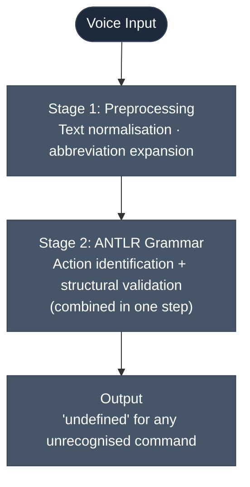
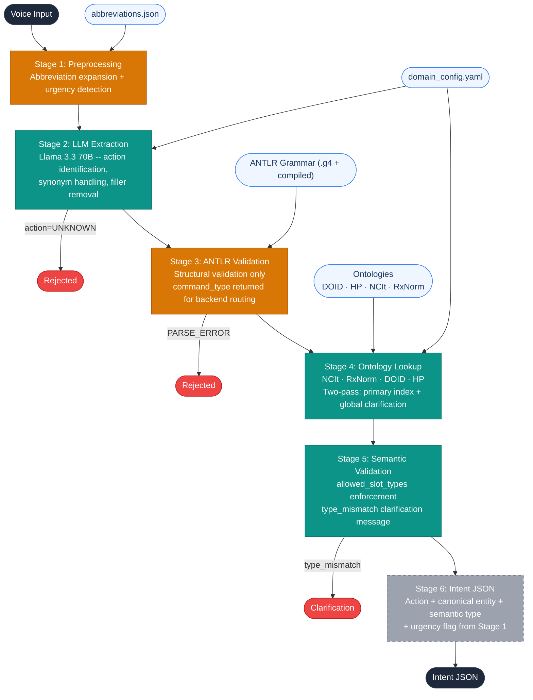

# Pipeline Evolution: Baseline vs Enhanced

> Master Thesis · TU Dresden · Software Technology  
> *Improving Intent Recognition in Grammar-Based Voice Interfaces*

Diagrams render in GitLab, GitHub, and VS Code with the Markdown Preview Mermaid Support extension. The interactive HTML version is at `docs/pipeline_evolution.html`.

---

## Ludyga's Baseline (2021)

Ludyga's system was a two-stage pipeline: basic text normalisation followed by ANTLR grammar matching that did both action identification and structural validation in one step. It achieved 100% precision on invalid commands but only 50% recall on valid ones -- the grammar was too strict to handle anything spoken informally.

---

## Enhanced Pipeline (This Thesis)

The enhanced pipeline keeps ANTLR as the structural authority but splits its responsibilities. A new LLM extraction stage (Stage 2) sits between preprocessing and grammar validation, handling the parts a lexer cannot: filler words, synonym variation, and natural phrasing. ANTLR (Stage 3) then validates the LLM's output against the same grammar rules and remains the gatekeeping step it always was.

Stages 4 and 5 are entirely new. Stage 4 resolves the extracted entity against real medical ontologies and flags type mismatches. Stage 5 enforces the semantic constraint for each action and generates a human-readable clarification message. Stage 6 (Intent JSON) assembles everything into the final structured payload.

---

## Colour Coding

| Colour | Meaning |
|--------|---------|
| Slate | Original Ludyga stage, unchanged in role |
| Amber | Stage existed before but was updated or repurposed |
| Teal | New stage added in this thesis |
| Grey dashed | Pending implementation |
| Red | Rejection / clarification path |
| Blue (light) | Configuration inputs (not stages) |

---

## What the Diagram Shows

The key architectural change is the **separation of concerns** in what was originally a single ANTLR step:

- **What moved to Stage 2 (LLM)**: action identification, synonym normalisation, filler word removal, natural language understanding. These are things ANTLR lexer rules can never generalise over.
- **What stayed in Stage 3 (ANTLR)**: structural validation -- does the entity have the required format? Is the command type correct? These are things a formal grammar expresses precisely and permanently.
- **What is new (Stages 4 and 5)**: semantic grounding. The LLM extracts "hemodialysis" as an entity; Stages 4 and 5 determine whether hemodialysis is the right *type* of thing for the requested action.

Stage 1 is largely unchanged from Ludyga, with urgency detection added. `domain_config.yaml` is new and drives Stages 2, 4, and 5 with no hardcoded action names in code.

---

## Result

Across 243 test commands (130 valid, 113 invalid), the enhanced pipeline raises binary accuracy from 75.3% to 95.9%, valid recall from 50.0% to 98.5% (128/130), and invalid precision from 100% to 92.9% (105/113). The drop in invalid precision is deliberate: Ludyga's 100% was achieved by rejecting almost everything, including valid commands. The enhanced pipeline accepts borderline valid commands that the grammar could not handle, which naturally lowers precision slightly while making the system practically usable.
