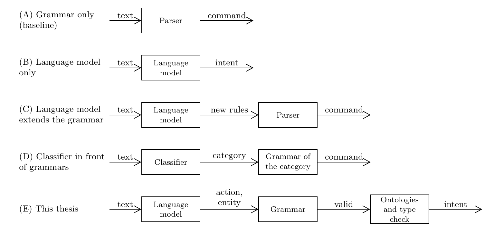
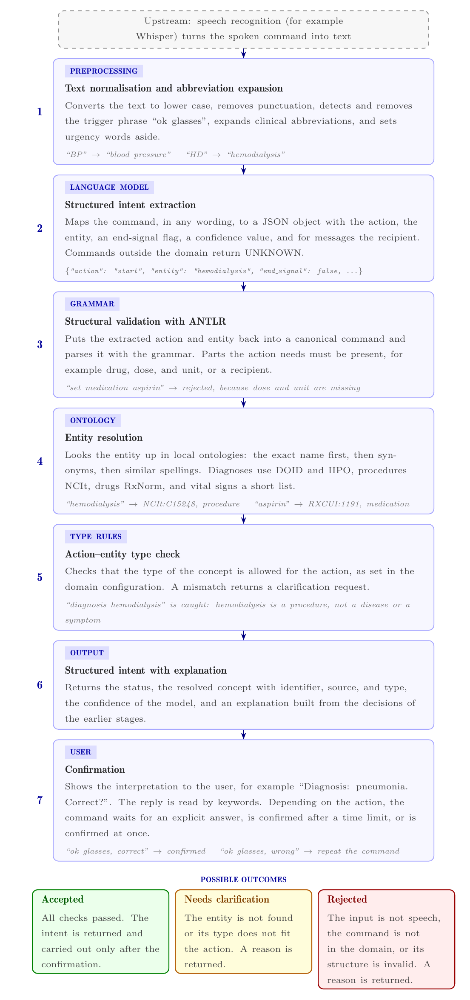

# Pipeline Evolution: Baseline vs Enhanced

> Master Thesis · TU Dresden · Software Technology  
> *Improving Intent Recognition in Grammar-Based Voice Interfaces*

This page compares the baseline of Ludyga (2024) with the pipeline of this thesis. The figures are the thesis figures (see `uml_diagrams.md`).

---

## Ludyga's Baseline (2024)

Ludyga's system is a grammar-based speech control with two steps. A preprocessing step checks that the input is usable and normalises the text (lower case, no punctuation, number words as digits, text before the trigger removed). A context-free grammar in ANTLR then parses the text, in one step that identifies the action and validates the structure. A command that matches the grammar becomes a JSON object. Any other input is rejected.

Ludyga evaluated the grammar on 100 valid and 100 invalid sample commands. Its language validation accuracy was 75.5 %, and the average response time was 195 ms. Only about half of the valid commands were accepted, because every wording that is not in the grammar is rejected. In this thesis the grammar is the baseline B0 (alternative A in the figure below).

## Enhanced Pipeline (This Thesis)

The enhanced pipeline keeps ANTLR for the structure and splits the work of the original single step:

- **Stage 1 Preprocessing:** normalisation, trigger, abbreviations, urgency flags, rejection of non-speech.
- **Stage 2 Language model:** reads the free wording and returns the action and the entity. This replaces the closed vocabulary.
- **Stage 3 Grammar:** checks the structure of the command that is rebuilt from the action and the entity.
- **Stage 4 Ontology lookup:** finds the entity in DOID, HPO, the NCI Thesaurus, or RxNorm.
- **Stage 5 Type check:** compares the type of the entity with the types that the action allows.
- **Stage 6 Intent:** the structured result with an explanation that the pipeline builds itself.
- **Stage 7 Confirmation:** shows the interpretation to the user before it is acted on.

## What Moved Where

- **Moved to Stage 2 (language model):** the identification of the action, synonyms, filler words, and abbreviations of the wording. A grammar cannot generalise over these.
- **Stayed in Stage 3 (ANTLR):** the check of the structure. Does a medication have a drug, a dose, and a unit? Does a message have a recipient? A formal grammar expresses this exactly.
- **New (Stages 4 and 5):** the grounding of the entity and the type check. The language model extracts "hemodialysis"; Stages 4 and 5 find that hemodialysis is a procedure and that a diagnosis expects a disease or a symptom.
- **New (Stage 7):** the confirmation.

`domain_config.yaml` is new. It drives the prompt, the lookup, and the confirmation, so that no action names are fixed in the code.

## Result

On 243 commands (130 valid, 113 invalid), with three repetitions for each model (first run):

| System | Accuracy | Valid accepted | Invalid wrongly accepted |
|---|---|---|---|
| B0, Ludyga's grammar | 70.8 % | 46.2 % | 0.9 % |
| Pipeline, six systems (four models, two token budgets) | 90.1 to 95.9 % | 83.1 to 96.9 % | 1.8 to 7.1 % |

Gemma 4 has the highest accuracy, 95.9 %, and the lowest median response time, 0.37 s in the first run and 0.77 s in a second run (the time depends on the load of the model service). The full results, the response times, and the analysis are in Chapter 7 of the thesis and in `evaluation/reports/final/`.
