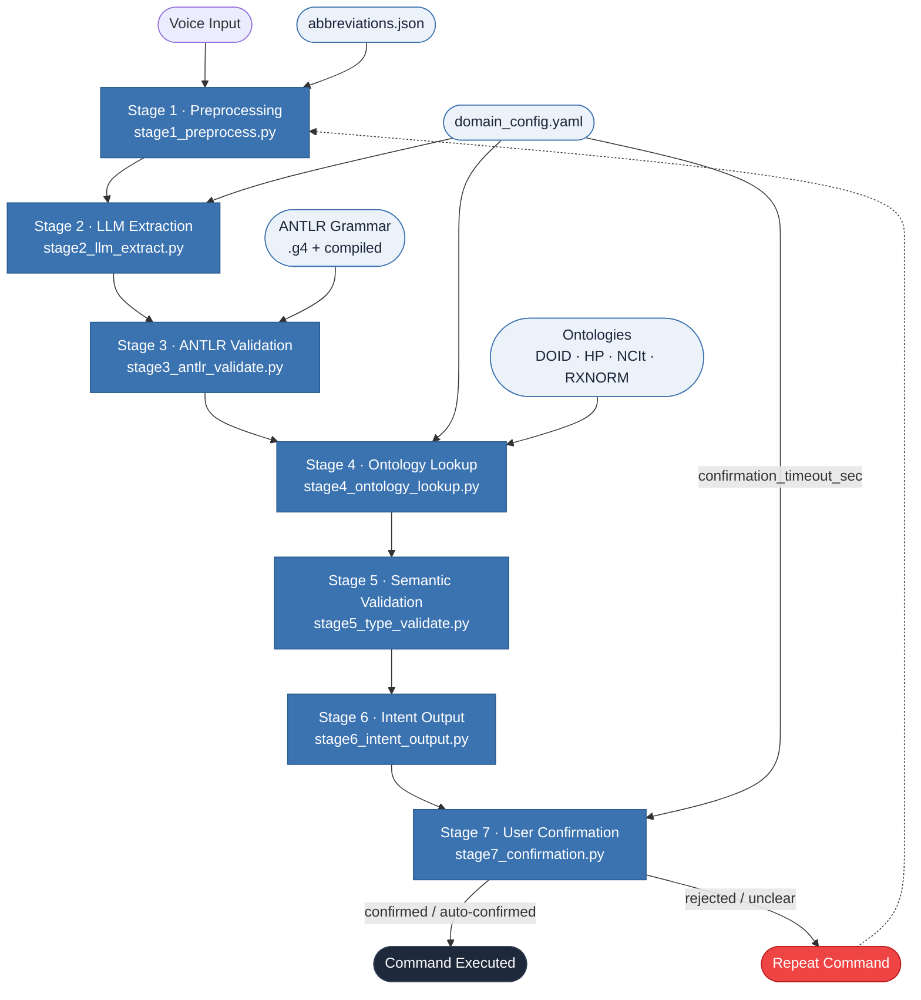
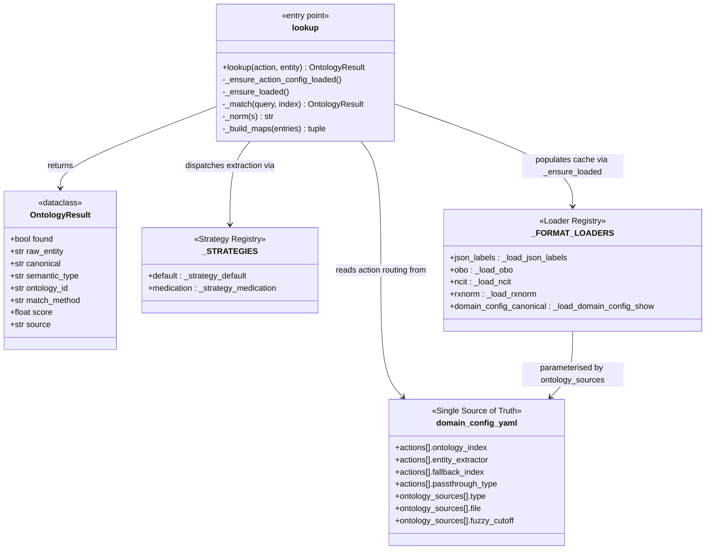
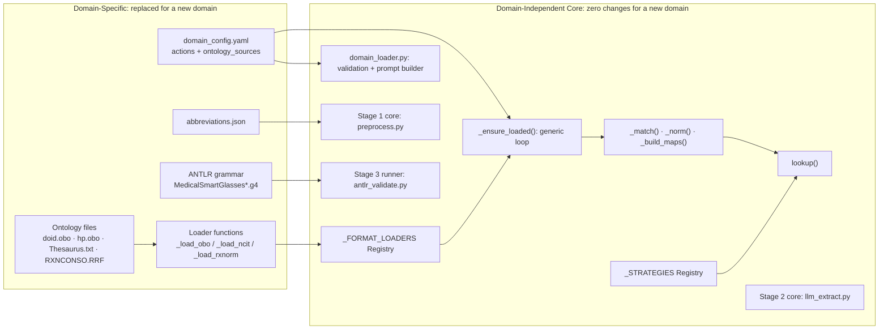

# Pipeline Architecture: UML Diagrams

> Master Thesis · TU Dresden · Software Technology  
> *Improving Intent Recognition in Grammar-Based Voice Interfaces*

Diagrams render in GitLab, GitHub, and VS Code with the Markdown Preview Mermaid Support extension.

---

## Figure 1 · Pipeline Architecture (Component Flow)

Seven-stage pipeline from raw voice input to a confirmed, executable command.
Stages 1-7 implemented.

---

## Figure 2 · Stage 4 Design Patterns (Class Diagram)

Stage 4 applies the **Strategy pattern** (pluggable entity extraction) and the **Registry pattern** (pluggable format loaders).
`domain_config.yaml` is the single source of truth for all routing decisions.

**Patterns applied:**

| Pattern | Where | Extensibility benefit |
|---------|--------|-----------------------|
| Strategy | `_STRATEGIES` dispatch table | New entity extraction logic = new function + one YAML key |
| Registry | `_FORMAT_LOADERS` dict | New ontology file format = new loader function + register |
| Single Source of Truth | `domain_config.yaml` | Action routing, file paths, cutoffs; all in one place; zero hardcoding in routing code |

---

## Figure 3 · Domain Independence Boundary (Component Diagram)

Separates the **domain-independent core** (unchanged for any new domain) from **domain-specific parts** (replaced when adapting to industry, transportation, tourism, etc.).  
Satisfies the *Domain Independence* non-functional requirement.

**Adapting to a new domain requires:**
1. New `domain_config.yaml`: actions, descriptions, ontology sources, rules, examples
2. New ANTLR grammar `.g4` + recompile
3. New ontology data files + loader functions for any new file formats (registered in `_FORMAT_LOADERS`)
4. New `abbreviations.json` for domain abbreviations

Everything else reuses unchanged.
