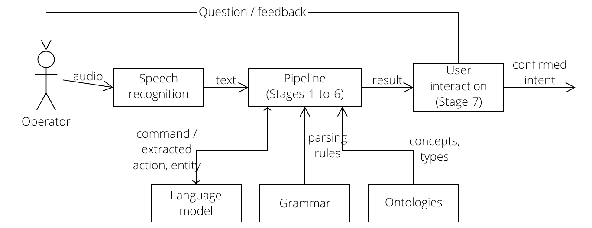
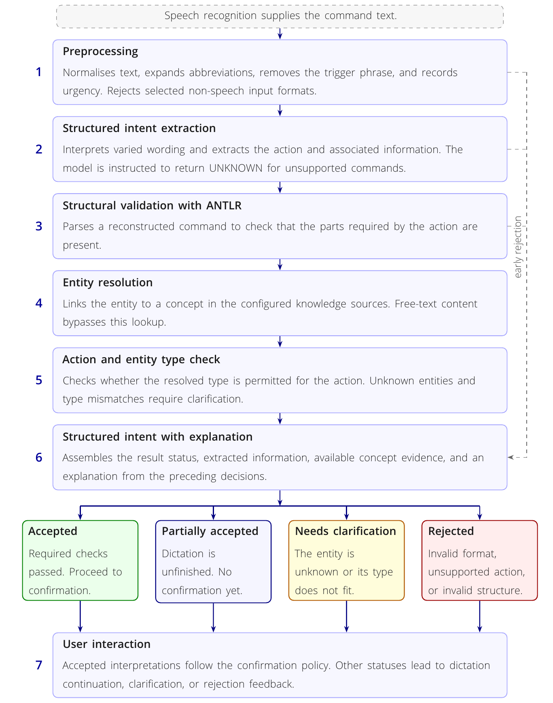
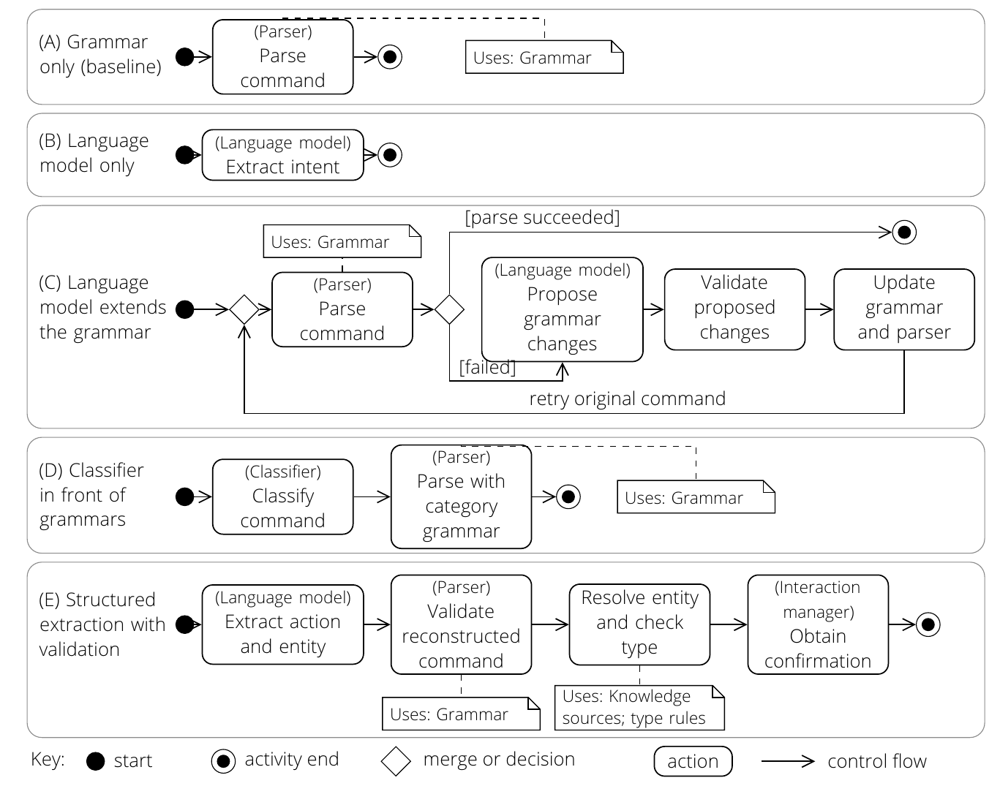
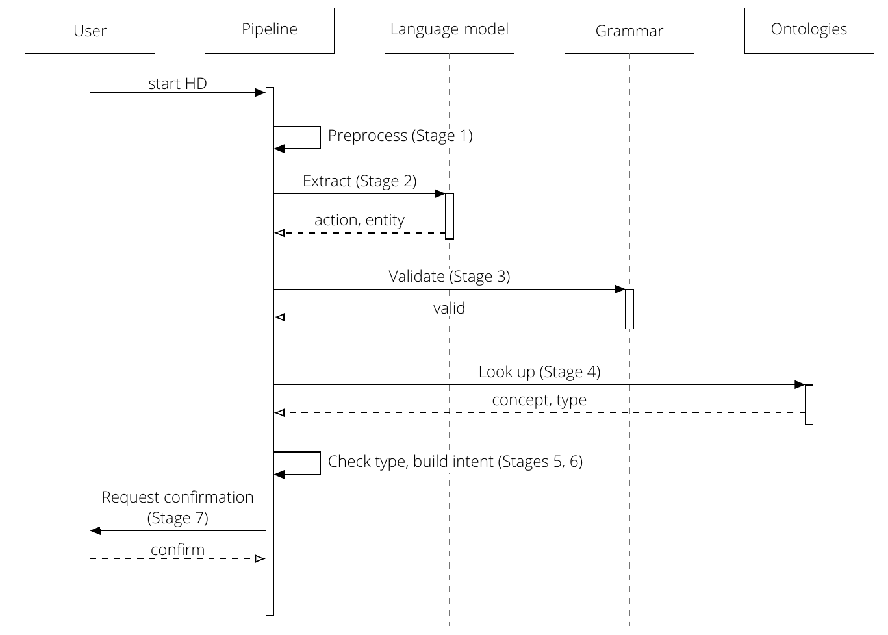
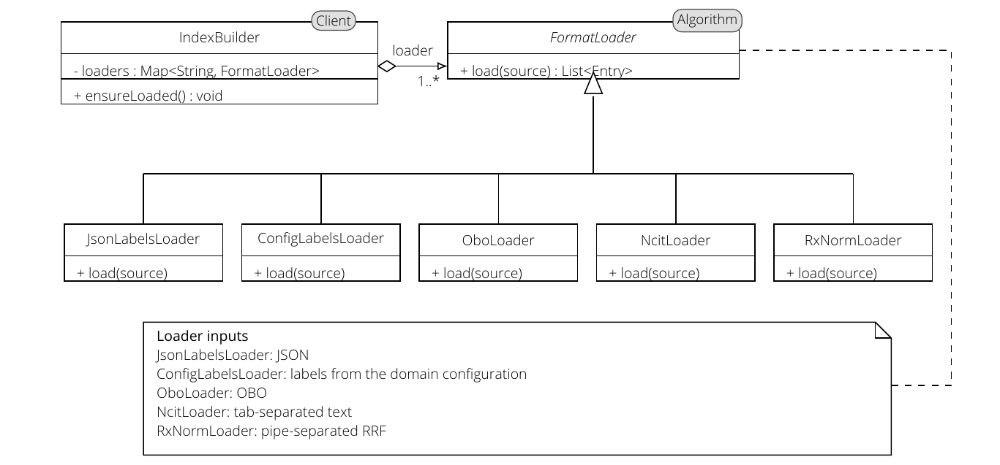
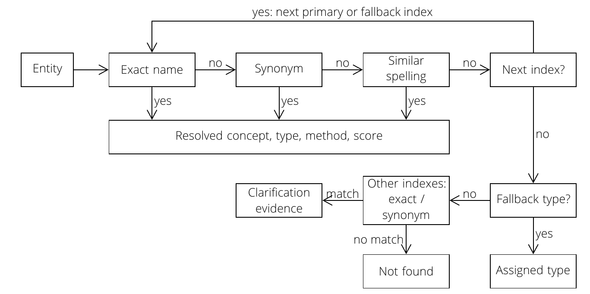
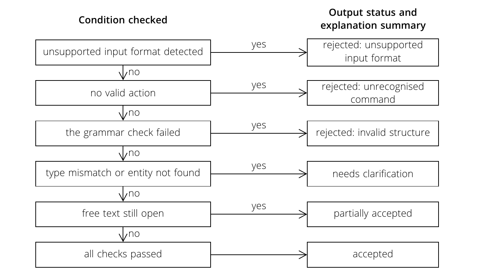
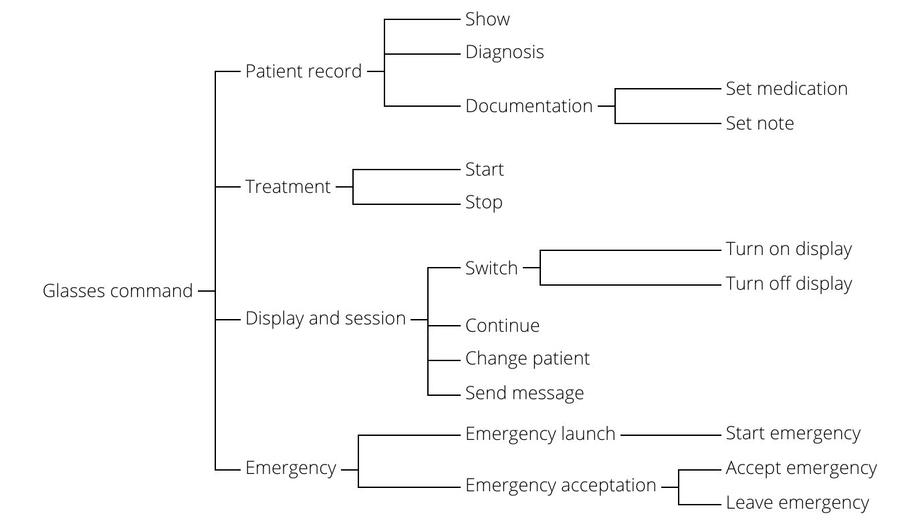

# Architecture Diagrams

> Master Thesis · TU Dresden · Software Technology  
> *Improving Intent Recognition in Grammar-Based Voice Interfaces*

These are the current diagrams of the thesis (Chapter 5 Design, Chapter 6 Implementation, Appendix A), exported from the TikZ sources in `latex-template-cgv-2/fig/` using the thesis preamble. Each diagram is available as a PNG preview in `figures/`.

The design alternatives use **UML activity diagrams**. The component diagram, sequence diagram, and two class diagrams also use UML. The system context, pipeline overview, Stage 4 and Stage 6 flow diagrams, and command tree provide other views and are not labelled as UML in the thesis.

| Figure | Type | Thesis | File |
|---|---|---|---|
| System context and supporting resources | system context | Section 5.2 | `figures/system_context.png` |
| The seven stages | informal | Section 5.2 | `figures/pipeline_architecture.png` |
| Design alternatives A to E | **UML activity diagrams** | Section 5.1.1 | `figures/flow_alternatives.png` |
| Entity matching and fallback routing | flow diagram | Section 5.3 | `figures/flow_stage4.png` |
| Status selection and explanation output | flow diagram | Section 5.3 | `figures/flow_stage6.png` |
| Pipeline and domain package | **UML component diagram** | Section 5.4 | `figures/component_domain.png` |
| Worked example "start HD" | **UML sequence diagram** | Section 5.4.2 | `figures/sequence_example.png` |
| Preparation of the entity (Stage 4) | **UML class diagram** | Section 6.3 | `figures/class_entity_strategy.png` |
| Loading of the ontology sources (Stage 4) | **UML class diagram** | Section 6.3 | `figures/class_loader_registry.png` |
| Supported action hierarchy | command tree | Appendix A | `figures/tree_commands.png` |

---

## System Context and Supporting Resources

The language model, the grammar, and the ontologies serve the pipeline. The user talks only to the speech recognition and to the confirmation.

## The Seven Stages

## Design Alternatives

Alternative A is the grammar of Ludyga (the baseline). Alternative E is this thesis.

---

## Domain Independence: UML Component Diagram

Everything that changes with the domain is in the **domain package**: the configuration, the grammar, the ontology data, and the abbreviations. The stages read it through the domain loader and directly. Notation: a ball is a provided interface, a socket is a required interface, a small square is a port, and a dashed arrow is a usage dependency.

**Adapting to a new domain requires:**
1. a new `domain_config.yaml` with the actions, the allowed entity types, the grammar templates, the prompt rules and examples, and the ontology sources;
2. a new ANTLR grammar and a new parser generated from it;
3. new ontology files, and one loader function (registered in `_FORMAT_LOADERS`) for each file format that the code does not read yet;
4. a new `abbreviations.json`.

The processing stages can be reused across domains. The prompt template and remaining domain-specific code details require review when adapting the implementation (see Section 5.4.1 of the thesis).

## Worked Example: UML Sequence Diagram

The command "start HD" through the pipeline. Parenthesised labels identify the stages; the confirmation reply is illustrative.

## Stage 4: UML Class Diagrams (Strategy Pattern)

These are the design view. In the code, the strategies and the loaders are plain functions that are stored in the dictionaries `_STRATEGIES` and `_FORMAT_LOADERS`, which act as registries.

---

## Other Current Thesis Diagrams

The separate [software architecture draft](figures/architecture-draft/software_architecture_draft.pdf) is under review and is not included in the thesis.

*Sources: `latex-template-cgv-2/fig/*.tex`. The exported PNG diagrams use the thesis preamble and fonts.*
