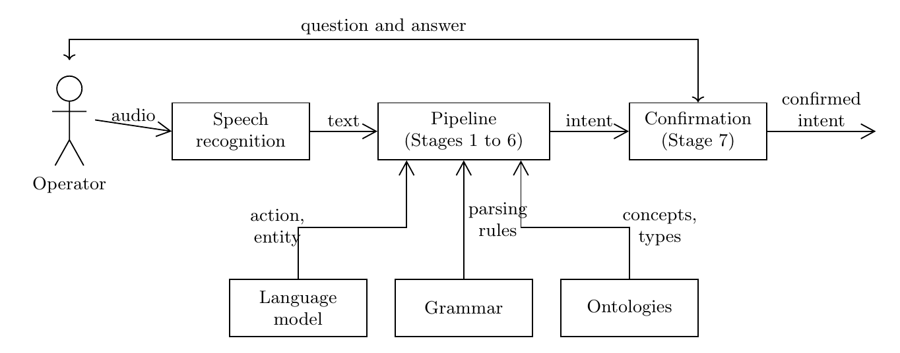
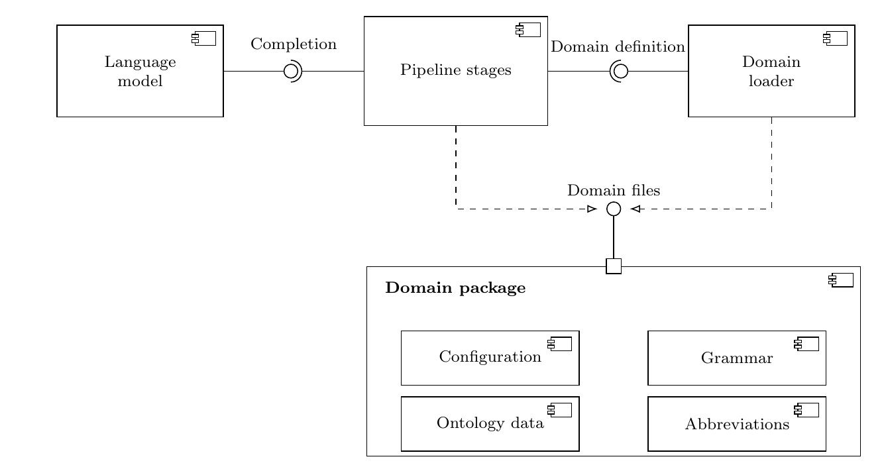
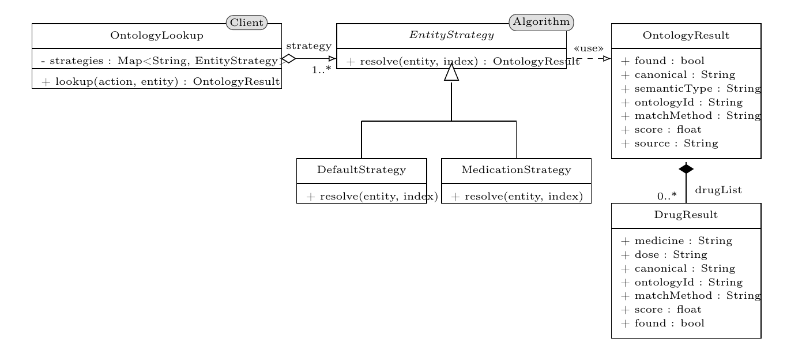

# Architecture Diagrams

> Master Thesis · TU Dresden · Software Technology  
> *Improving Intent Recognition in Grammar-Based Voice Interfaces*

These are the diagrams of the thesis (Chapter 5 Design, Chapter 6 Implementation, Appendix A). They are exported from the TikZ sources in `latex-template-cgv-2/fig/` and replace the earlier Mermaid diagrams, which did not follow UML (for example, the component diagram had no interfaces and mixed the domain model with a class diagram).

Three figures are **UML**: the sequence diagram, the component diagram, and the two class diagrams. The other figures are informal data-flow figures, and they are not called UML in the thesis. The detail figures of Stage 4, Stage 6, and the command tree are only in the thesis.

| Figure | Type | Thesis | File |
|---|---|---|---|
| Data flow of the system | data flow | Section 5.2 | `figures/dataflow_system.png` |
| The seven stages | informal | Section 5.2 | `figures/pipeline_architecture.png` |
| Design alternatives A to E | data flow | Section 5.1 | `figures/flow_alternatives.png` |
| Pipeline and domain package | **UML component diagram** | Section 5.6 | `figures/component_domain.png` |
| Worked example "start HD" | **UML sequence diagram** | Section 5.7 | `figures/sequence_example.png` |
| Preparation of the entity (Stage 4) | **UML class diagram** | Section 6.3 | `figures/class_entity_strategy.png` |
| Loading of the ontology sources (Stage 4) | **UML class diagram** | Section 6.3 | `figures/class_loader_registry.png` |

---

## Data Flow of the System

The language model, the grammar, and the ontologies serve the pipeline. The user talks only to the speech recognition and to the confirmation.

## The Seven Stages

## Design Alternatives

Alternative A is the grammar of Ludyga (the baseline). Alternative E is this thesis.

---

## Domain Independence: UML Component Diagram

Everything that changes with the domain is in the **domain package**: the configuration, the grammar, the ontology data, and the abbreviations. The stages read it through the domain loader and directly. Notation: a ball is a provided interface, a socket is a required interface, a small square is a port, and a dashed arrow is a usage dependency.

**Adapting to a new domain requires:**
1. a new `domain_config.yaml` with the actions, the allowed entity types, the grammar templates, the prompt rules and examples, and the ontology sources;
2. a new ANTLR grammar and a new parser generated from it;
3. new ontology files, and one loader function (registered in `_FORMAT_LOADERS`) for each file format that the code does not read yet;
4. a new `abbreviations.json`.

The seven stages and the prompt template are the same for every domain. A few domain-specific details are still in the code (see Section 4.2, NFR4, of the thesis).

## Worked Example: UML Sequence Diagram

The command "start HD" through the pipeline. The numbers are the stages.

## Stage 4: UML Class Diagrams (Strategy Pattern)

These are the design view. In the code, the strategies and the loaders are plain functions that are stored in the dictionaries `_STRATEGIES` and `_FORMAT_LOADERS`, which act as registries.

---

*Sources: `latex-template-cgv-2/fig/*.tex`. To export a figure again, compile it with the `standalone` class and convert the PDF with `pdftoppm`.*
